# คู่มือผู้ใช้งาน — ร้านอาหารและร้านกาแฟ

คู่มือนี้อธิบายการใช้งาน **โหมดร้านอาหาร / ร้านกาแฟ (F&B)** ของระบบ POS ทีละหน้าจอ ตั้งแต่รับออร์เดอร์หน้าเคาน์เตอร์ ส่งครัว ดูแลโต๊ะ ให้ลูกค้าสั่งเองจาก QR ไปจนถึงเก็บเงิน ปิดโต๊ะ และดูรายงานว่าจานไหนทำกำไร

ภาพประกอบทุกภาพถ่ายจากระบบจริง (ร้านตัวอย่าง) ชื่อปุ่มในคู่มือตรงกับที่แสดงบนหน้าจอภาษาไทย สลับเป็นภาษาอังกฤษได้ทุกหน้าด้วยปุ่ม **TH / EN** มุมขวาบน

เอกสารที่เกี่ยวข้อง: [คู่มือผู้ใช้งานระบบร้านค้า](USER_GUIDE.md) (เข้าสู่ระบบ สินค้า สต็อก สมาชิก รายงานร้านค้า ตั้งค่าร้าน) · [คู่มือติดตั้งหน้างาน](INSTALL_ONSITE.md) (เครื่องพิมพ์ ลิ้นชัก สแกนเนอร์) · [แผนพัฒนา F&B](FNB_POS_PLAN.md)

---

## สารบัญ

1. [ภาพรวม: ใครใช้หน้าจอไหน](#1-ภาพรวม-ใครใช้หน้าจอไหน)
2. [เริ่มต้นใช้งานร้านใหม่ — ลำดับการตั้งค่า](#2-เริ่มต้นใช้งานร้านใหม่--ลำดับการตั้งค่า)
3. [สั่งหน้าเคาน์เตอร์](#3-สั่งหน้าเคาน์เตอร์)
4. [ชำระเงินและใบเสร็จ](#4-ชำระเงินและใบเสร็จ)
5. [จอครัว (KDS) และตั๋วครัว](#5-จอครัว-kds-และตั๋วครัว)
6. [ผังโต๊ะ](#6-ผังโต๊ะ)
7. [ย้าย/รวมโต๊ะ และแยกบิล](#7-ย้ายรวมโต๊ะ-และแยกบิล)
8. [จอเรียกคิว](#8-จอเรียกคิว)
9. [QR โต๊ะ — ลูกค้าสั่งเอง](#9-qr-โต๊ะ--ลูกค้าสั่งเอง)
10. [จอง / รอคิว](#10-จอง--รอคิว)
11. [รายงานร้านอาหาร](#11-รายงานร้านอาหาร)
12. [ตั้งค่า](#12-ตั้งค่า)
13. [สูตรอาหารและการตัดสต็อกวัตถุดิบ](#13-สูตรอาหารและการตัดสต็อกวัตถุดิบ)
14. [หลายสาขา (สำนักงานใหญ่)](#14-หลายสาขา-สำนักงานใหญ่)
15. [ปัญหาที่พบบ่อยและวิธีแก้](#15-ปัญหาที่พบบ่อยและวิธีแก้)
16. [ภาคผนวก](#16-ภาคผนวก)

---

## 1. ภาพรวม: ใครใช้หน้าจอไหน

โหมดร้านอาหารอยู่ที่ที่อยู่เว็บ `/fnb` ของร้าน มีแถบเมนูของตัวเองด้านบน 8 หน้า

| หน้าจอ | ใครใช้ | เปิดค้างไว้ที่ไหน |
|---|---|---|
| **สั่งหน้าเคาน์เตอร์** | แคชเชียร์ / บาริสต้า | เครื่องเคาน์เตอร์ |
| **จอครัว** | ครัว / บาร์ | จอในครัว (เปิดได้หลายจอพร้อมกัน) |
| **ผังโต๊ะ** | พนักงานเสิร์ฟ / ผู้จัดการ | แท็บเล็ตของเสิร์ฟ หรือเครื่องเคาน์เตอร์ |
| **จอเรียกคิว** | ลูกค้าดู | ทีวีหน้าเคาน์เตอร์ |
| **จอง / รอคิว** | พนักงานต้อนรับ | เครื่องหน้าร้าน |
| **QR โต๊ะ** | ผู้จัดการ (ตั้งครั้งเดียว) | — |
| **รายงาน** | ผู้จัดการ / เจ้าของ | — |
| **ตั้งค่า** | ผู้จัดการ / เจ้าของ | — |

> **สิทธิ์** — แคชเชียร์เข้าได้ทุกหน้าที่ใช้ขาย (เคาน์เตอร์ ครัว ผังโต๊ะ คิว จอง QR) แต่ **รายงาน** และ **ตั้งค่า** เห็นเฉพาะผู้จัดการและเจ้าของร้าน (แถบเมนูจะซ่อน 2 หน้านี้ให้อัตโนมัติ)

ทุกหน้าจอเชื่อมกัน **แบบเรียลไทม์** — กดที่เครื่องหนึ่ง อีกเครื่องเห็นภายในเสี้ยววินาที โดยไม่ต้องรีเฟรช ถ้าเน็ตสะดุด ระบบจะกลับไปดึงข้อมูลทุก 3 วินาทีจนกว่าจะต่อกลับได้

---

## 2. เริ่มต้นใช้งานร้านใหม่ — ลำดับการตั้งค่า

ทำครั้งเดียวตอนเปิดร้าน ตามลำดับนี้ (รายละเอียดแต่ละหน้าอยู่ในข้อ 12)

1. **สถานีครัว** — สร้างจุดที่ทำอาหาร เช่น บาร์เครื่องดื่ม, ครัวร้อน, ของหวาน และเลือกว่าสถานีนั้นดูงานจาก **จอ**, **กระดาษ** หรือ **ทั้งคู่**
2. **วัตถุดิบ** — เพิ่มวัตถุดิบเป็น "สินค้า" ในระบบร้านค้า (เมนู **สินค้า** ฝั่งหลังร้าน) พร้อมหน่วยนับและต้นทุน เช่น เมล็ดกาแฟ (กรัม), นมสด (ลิตร)
3. **หมวดและเมนู** — สร้างหมวด (กาแฟ, ข้าว, ของหวาน…) แล้วเพิ่มเมนูพร้อม **ราคา**, **สถานีครัว**, **ช่องทางที่ขาย** และ **สูตร** (วัตถุดิบที่จะตัดสต็อก)
4. **ตัวเลือก** — สร้างกลุ่มตัวเลือก เช่น ขนาด, ร้อน/เย็น, ความหวาน, เพิ่มช็อต แล้วผูกเข้ากับเมนู
5. **โต๊ะ / โซน** — วาดผังร้าน: สร้างโซน (ในร้าน, ระเบียง, บาร์) แล้ววางโต๊ะ
6. **สต็อก / เงิน** — เลือกจังหวะตัดสต็อก, ค่าบริการ %, VAT และกติกา QR
7. **QR โต๊ะ** — เปิดหน้าจอประจำโต๊ะบนแท็บเล็ต หรือพิมพ์สลิป QR วางโต๊ะ

> **ทางลัด** — ถ้าต้องการข้อมูลตัวอย่างไว้ลองเล่นก่อน (เมนู 18 รายการ วัตถุดิบ 29 ชนิด พร้อมสูตรและโต๊ะ 14 ตัว) ให้ผู้ดูแลระบบรัน `npm run` สคริปต์ `fnb-seed-demo.mjs` ตามที่อธิบายใน [FNB_POS_PLAN.md](FNB_POS_PLAN.md)

---

## 3. สั่งหน้าเคาน์เตอร์

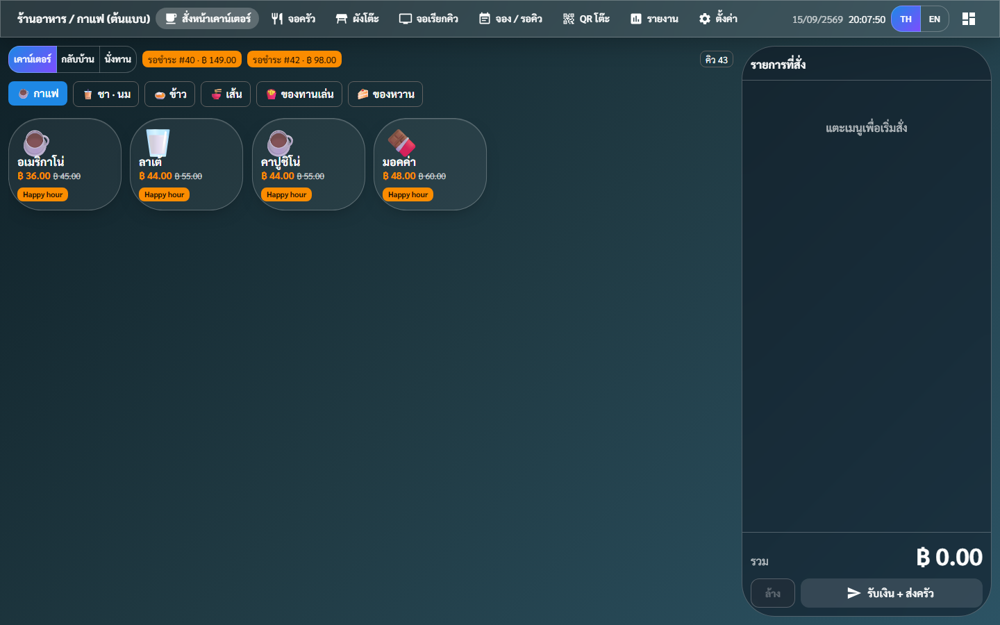

หน้าจอนี้ใช้รับออร์เดอร์ที่เคาน์เตอร์ ทั้งลูกค้าซื้อกลับและลูกค้านั่งทาน

### 3.1 ส่วนประกอบ

| ส่วน | ความหมาย |
|---|---|
| **เคาน์เตอร์ / กลับบ้าน / นั่งทาน** | ช่องทางของออร์เดอร์ — เลือกก่อนกดเมนู |
| ชิปสีส้ม **รอชำระ #40 · ฿149.00** | ออร์เดอร์ที่ส่งครัวไปแล้วแต่ยังไม่ได้เก็บเงิน กดที่ชิปเพื่อเปิดหน้าชำระเงินของออร์เดอร์นั้น |
| **คิว 43** (มุมขวาบน) | หมายเลขคิวที่ออร์เดอร์ถัดไปจะได้ (นับใหม่ทุกวัน) |
| แถวหมวด | กาแฟ · ชา·นม · ข้าว · เส้น · ของทานเล่น · ของหวาน |
| ไทล์เมนู | รูป/อีโมจิ ชื่อ และราคา — ถ้ามีโปรโมชันจะขึ้นราคาโปรพร้อมขีดฆ่าราคาเดิมและป้ายชื่อโปร |
| **รายการที่สั่ง** (ขวา) | ตะกร้าปัจจุบัน ปรับจำนวนด้วย − / + ลบด้วยถังขยะ |
| **รวม** | ยอดของตะกร้า (ยังไม่รวมค่าบริการ/VAT ซึ่งคิดตอนชำระ) |

### 3.2 ขั้นตอนรับออร์เดอร์

1. เลือกช่องทาง — **เคาน์เตอร์** (รับที่เคาน์เตอร์), **กลับบ้าน**, หรือ **นั่งทาน**
2. ถ้าเลือก **นั่งทาน** จะมีแถวเลือกโต๊ะขึ้นมา (ชิปสีตามสถานะโต๊ะ) — ต้องเลือกโต๊ะก่อน ไม่งั้นระบบเตือน "เลือกโต๊ะก่อน"
3. แตะหมวด แล้วแตะเมนู
   - เมนูที่ไม่มีตัวเลือก → ลงตะกร้าทันที
   - เมนูที่มีตัวเลือก → เปิดหน้าต่างให้เลือก (ข้อ 3.3)
4. ตรวจตะกร้า ปรับจำนวน ใส่หมายเหตุถ้าจำเป็น
5. กดปุ่มล่างขวา
   - **รับเงิน + ส่งครัว** (เคาน์เตอร์ / กลับบ้าน) — ส่งครัวและเปิดหน้าชำระเงินทันที
   - **ส่งครัว** (นั่งทาน) — ส่งครัวก่อน เก็บเงินทีหลังตอนเช็คบิลที่โต๊ะ

### 3.3 หน้าต่างตัวเลือก

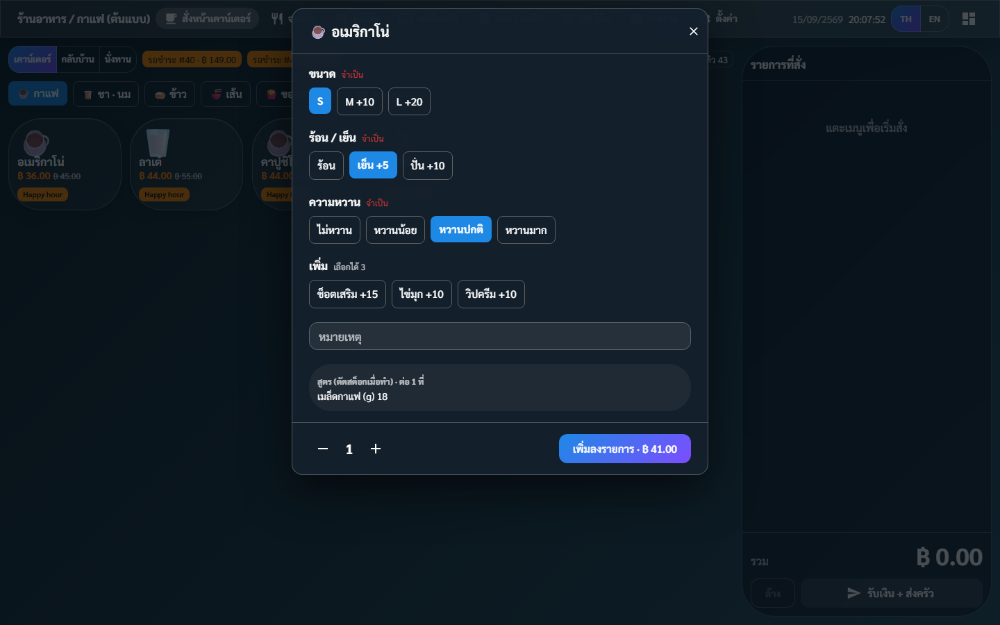

- กลุ่มที่ขึ้นคำว่า **จำเป็น** ต้องเลือกอย่างน้อย 1 อย่าง ปุ่มเพิ่มจะยังกดไม่ได้จนกว่าจะเลือกครบ
- กลุ่มที่เขียน **เลือกได้ {n}** เลือกได้หลายอย่างจนถึงจำนวนที่กำหนด
- ตัวเลือกที่บวกเงินจะแสดง **+15** ต่อท้ายชื่อ และราคารวมของบรรทัดจะอัปเดตที่ปุ่ม
- ช่อง **หมายเหตุ** ใช้พิมพ์คำสั่งพิเศษ เช่น "ไม่ใส่ผัก", "เผ็ดมาก" — ข้อความนี้จะไปโผล่บนตั๋วครัวเป็นตัวสีเหลืองมีเครื่องหมาย ⚠
- ปรับจำนวนด้วย − / + มุมซ้ายล่างของหน้าต่าง แล้วกด **เพิ่มลงรายการ**

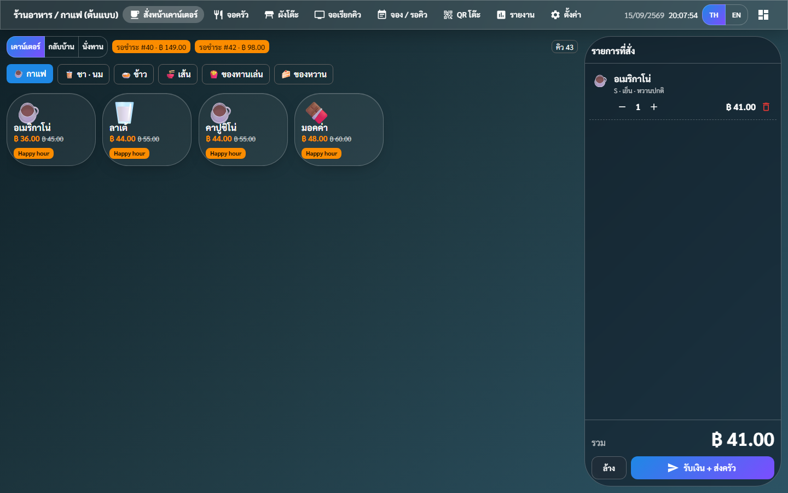

> **ทำไมบางเมนูไม่ขึ้นบนไทล์** — เมนูจะแสดงเฉพาะช่องทางที่ตั้งไว้ในหน้าตั้งค่า เช่น เมนูที่ติ๊กเฉพาะ "นั่งทาน" จะไม่ขึ้นตอนเลือกช่องทาง "กลับบ้าน" (ดูข้อ 12.1)

---

## 4. ชำระเงินและใบเสร็จ

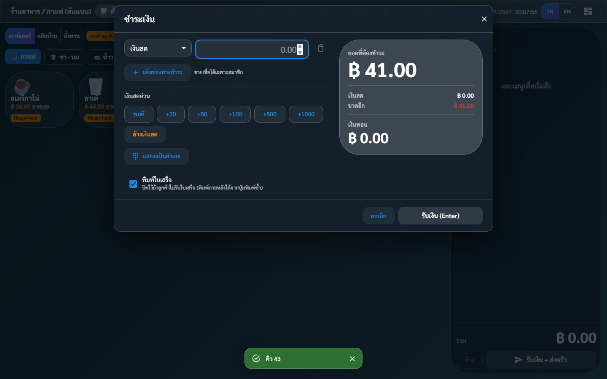

หน้าชำระเงินเป็นหน้าต่างเดียวกับที่ร้านค้าใช้ จึงได้ทุกอย่างเหมือนกัน

- **ช่องทางชำระ 8 แบบ** — เงินสด, เงินโอน, พร้อมเพย์ (QR), จีวอลเล็ต, ไทยพลัส, บัตรสวัสดิการแห่งรัฐ, บัตรเครดิต, ขายเชื่อ (เฉพาะสมาชิก)
- **แบ่งจ่ายหลายช่องทางในบิลเดียว** — กด **เพิ่มช่องทางชำระ** เช่น เงินสด 100 + โอน 114.50 (ใช้วิธีนี้เวลาลูกค้า "หารกัน" คนละครึ่งด้วย)
- **เงินสดด่วน** — ปุ่ม พอดี / +20 / +50 / +100 / +500 / +1000 และแป้นตัวเลขสำหรับจอสัมผัส
- **เงินทอน** คำนวณให้อัตโนมัติ และ **ปัดเศษ** ตามที่ตั้งไว้ในตั้งค่าร้าน
- ติ๊ก **พิมพ์ใบเสร็จ** ไว้ ระบบจะพิมพ์ทันทีที่กดรับเงิน (ถ้าตั้ง Chrome โหมด kiosk-printing ไว้จะไม่มีหน้าต่างถามพิมพ์)

**สิ่งที่เกิดขึ้นเมื่อกดรับเงิน**

1. ออร์เดอร์กลายเป็น **บิลจริง** ในระบบขาย มีเลขบิลรูปแบบเดียวกับร้านค้า
2. ค่าบริการ % และ VAT (ถ้าตั้งไว้) ถูกเพิ่มเป็นบรรทัดในบิล
3. ยอดเข้ากะ ลิ้นชักเปิด แดชบอร์ดและรายงานทุกใบเห็นบิลนี้ทันที
4. ใบเสร็จพิมพ์ออก และออร์เดอร์เปลี่ยนสถานะเป็น **จ่ายแล้ว**
5. **ไม่มีการตัดสต็อกซ้ำ** — วัตถุดิบถูกตัดไปตั้งแต่ตอนส่งครัวแล้ว (ดูข้อ 13)

> ออร์เดอร์ **เคาน์เตอร์/กลับบ้าน** ที่จ่ายแล้วจะปิดตัวเองเมื่อครัวเสิร์ฟครบทุกรายการ ส่วนออร์เดอร์ **นั่งทาน** ที่จ่ายแล้วจะยังค้างที่โต๊ะจนกว่าพนักงานจะกด **ปิดโต๊ะ**

---

## 5. จอครัว (KDS) และตั๋วครัว

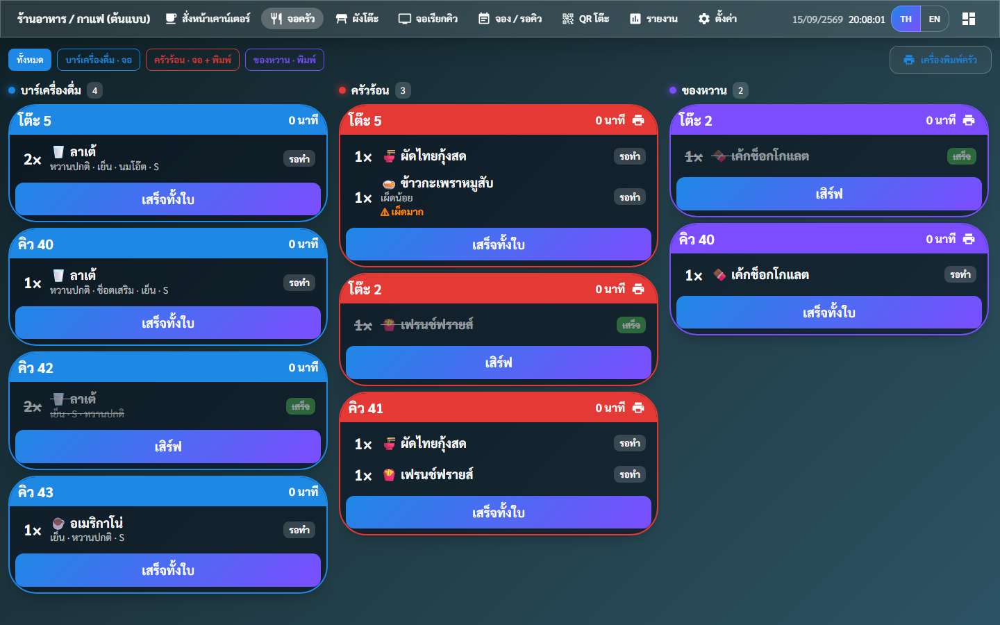

จอครัวแสดง **ตั๋ว** ของออร์เดอร์ที่ยังไม่เสร็จ แยกเป็นคอลัมน์ตามสถานี ออร์เดอร์เก่าอยู่บน

### 5.1 อ่านตั๋วอย่างไร

| สิ่งที่เห็น | ความหมาย |
|---|---|
| หัวตั๋วสีฟ้า/แดง/ม่วง | สีประจำสถานี |
| **โต๊ะ 5** หรือ **คิว 40** | ออร์เดอร์นั่งทานบอกเลขโต๊ะ · ออร์เดอร์เคาน์เตอร์บอกเลขคิว |
| **0 นาที** | เวลาที่ผ่านไปตั้งแต่ส่งครัว |
| ขอบตั๋วเปลี่ยนเป็น **ส้ม → แดง** และกะพริบ | ตั๋วใช้เวลาเกินเวลาปกติของเมนูนั้น (ตั๋วช้า) |
| ป้าย **รอทำ / กำลังทำ / เสร็จ** | สถานะรายจาน |
| ข้อความสีเหลือง ⚠ | หมายเหตุจากลูกค้า |
| ไอคอนเครื่องพิมพ์ที่หัวตั๋ว | กดเพื่อ **พิมพ์ตั๋วซ้ำ** (มีเฉพาะสถานีที่ตั้งให้ออกกระดาษ) |

### 5.2 การใช้งาน

- **แตะที่บรรทัด** — เปลี่ยนสถานะของจานนั้นทีละขั้น: รอทำ → กำลังทำ → เสร็จ → เสิร์ฟแล้ว (บรรทัดที่เสร็จจะจางและขีดฆ่า)
- **เสร็จทั้งใบ** — เปลี่ยนทุกจานของสถานีนั้นในตั๋วเป็น "เสร็จ" ทีเดียว
- **เสิร์ฟ** — ปุ่มจะเปลี่ยนเป็นสีเขียวคำว่า "เสิร์ฟ" เมื่อทุกจานเสร็จแล้ว กดแล้วตั๋วหายจากจอ
- ชิปด้านบนใช้กรองเฉพาะสถานีที่ต้องการ (**ทั้งหมด** = ดูทุกสถานี)

### 5.3 เครื่องพิมพ์ครัว

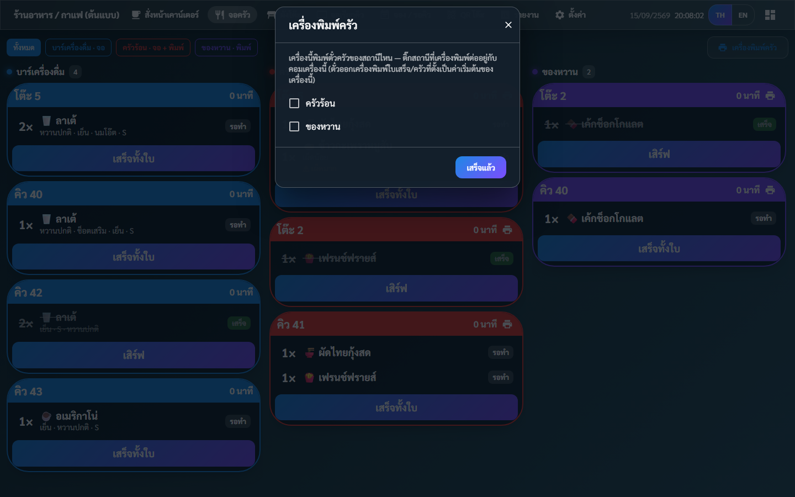

ถ้าครัวใช้กระดาษแทนจอ ให้ตั้งดังนี้

1. ที่หน้าตั้งค่า → **สถานีครัว** เลือก **แสดงผลที่** เป็น *กระดาษ* หรือ *จอ + กระดาษ*
2. ไปที่เครื่องที่ต่อกับเครื่องพิมพ์ครัวนั้น เปิดหน้า **จอครัว** ค้างไว้
3. กดปุ่ม **เครื่องพิมพ์ครัว** มุมขวาบน แล้วติ๊กสถานีที่เครื่องนี้รับผิดชอบ

ตั้งครั้งเดียว เครื่องจำไว้เอง จากนั้น **ทุกออร์เดอร์ที่เข้ามาจะพิมพ์ตั๋วออกทันที** โดยไม่ต้องมีโปรแกรมเสริม

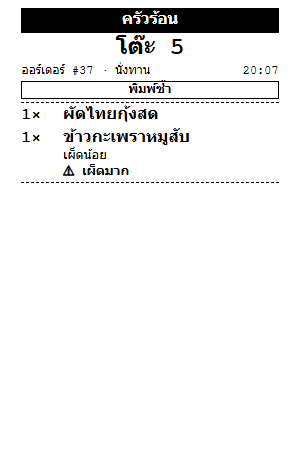

ตั๋วมี: ชื่อสถานี (แถบดำ) · เลขโต๊ะหรือคิวตัวใหญ่ · เลขออร์เดอร์ ช่องทาง และเวลา · รายการพร้อมตัวเลือกและหมายเหตุ

> ร้านเล็กที่มีเครื่องพิมพ์ใบเสร็จตัวเดียว ก็ติ๊กทุกสถานีที่เครื่องเคาน์เตอร์ แล้วเดินตั๋วเข้าครัวได้

---

## 6. ผังโต๊ะ

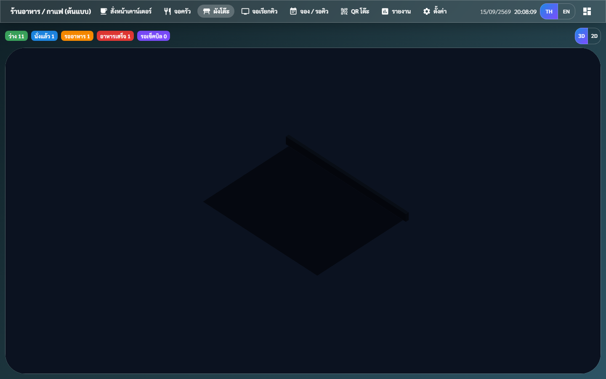

ผังโต๊ะคือหน้าจอหลักของพนักงานเสิร์ฟ — เห็นทั้งร้านในภาพเดียว โต๊ะเปลี่ยนสีตามสถานะ

### 6.1 สีของโต๊ะ

| สี | สถานะ | หมายถึง |
|---|---|---|
| 🟢 เขียว | **ว่าง** | ไม่มีออร์เดอร์ |
| 🔵 น้ำเงิน | **นั่งแล้ว** | เปิดโต๊ะแล้วแต่ยังไม่สั่ง |
| 🟠 ส้ม | **รออาหาร** | สั่งแล้ว ครัวกำลังทำ |
| 🔴 แดง (กะพริบ) | **อาหารเสร็จ** | มีจานพร้อมเสิร์ฟ — รีบไปเสิร์ฟ |
| 🟣 ม่วง | **รอเช็คบิล** | จ่ายเงินแล้ว รอปิดโต๊ะ |

แถบด้านบนสรุปจำนวนโต๊ะแต่ละสถานะ ปุ่ม **3D / 2D** สลับมุมมอง (ระบบสลับเป็น 2D ให้เองถ้าอุปกรณ์แสดง 3D ไม่ไหว)

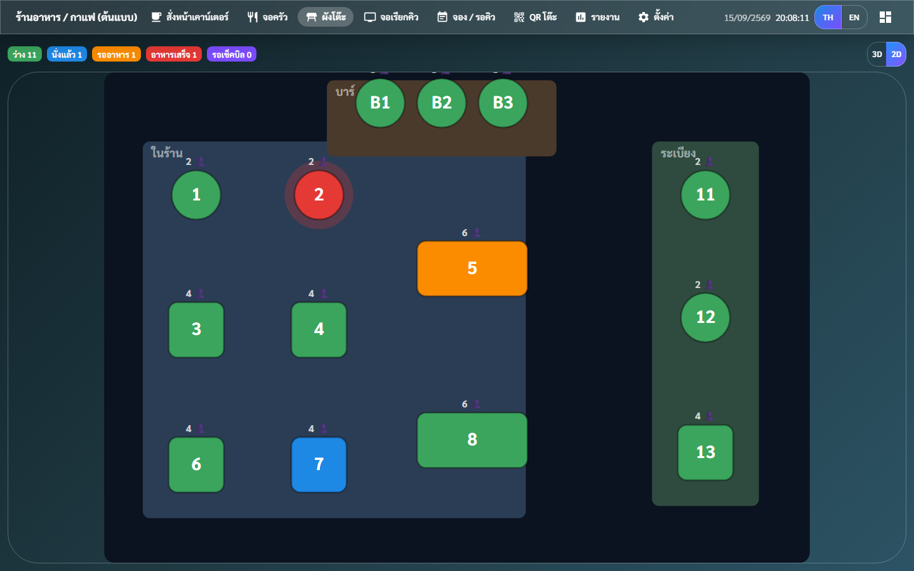

### 6.2 แผงโต๊ะ

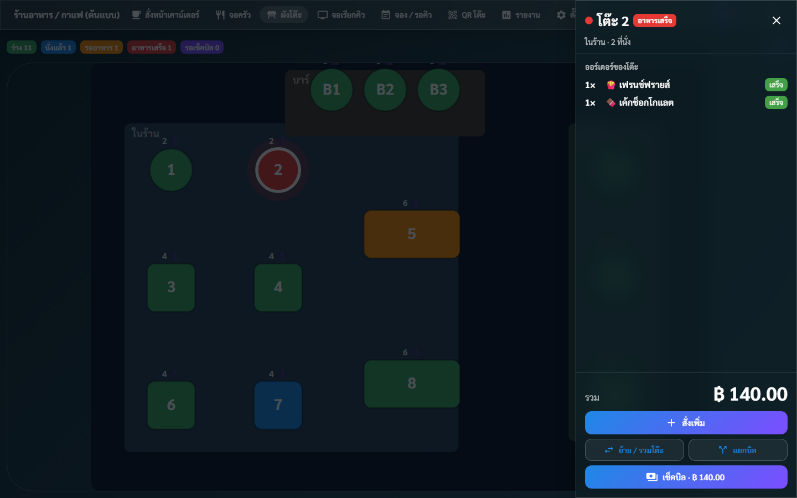

แตะที่โต๊ะ แผงด้านขวาจะเปิดขึ้น แสดงออร์เดอร์ทั้งหมดของโต๊ะ สถานะรายจาน และยอดรวม พร้อมปุ่ม

| ปุ่ม | ใช้เมื่อ |
|---|---|
| **เปิดโต๊ะ (ยังไม่สั่ง)** | พาลูกค้านั่ง แต่ยังไม่สั่ง — โต๊ะเปลี่ยนเป็นน้ำเงิน และ QR ของโต๊ะเริ่มรับออร์เดอร์ได้ (ดูข้อ 9.4) |
| **สั่งอาหาร / สั่งเพิ่ม** | เปิดเมนูสั่งให้โต๊ะนี้ |
| **ย้าย / รวมโต๊ะ** | ลูกค้าย้ายที่นั่ง หรือรวมสองโต๊ะเข้าด้วยกัน (ข้อ 7.1) |
| **แยกบิล** | ลูกค้าแยกจ่าย (ข้อ 7.2) |
| **เช็คบิล · ฿140.00** | เปิดหน้าชำระเงินรวมทุกออร์เดอร์ที่ยังไม่จ่ายของโต๊ะ |
| **ปิดโต๊ะ** | ลูกค้ากลับแล้ว — โต๊ะกลับเป็นสีเขียว **และ QR ของโต๊ะเปลี่ยนรหัสใหม่ทันที** |

---

## 7. ย้าย/รวมโต๊ะ และแยกบิล

### 7.1 ย้าย / รวมโต๊ะ

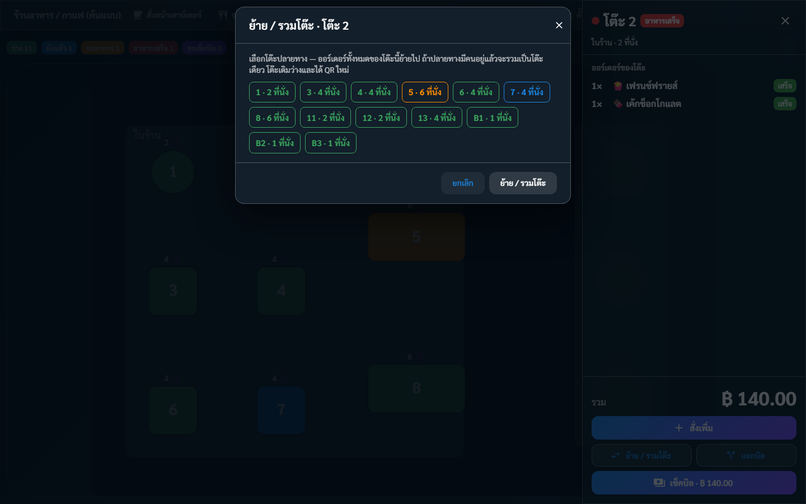

1. เปิดแผงโต๊ะต้นทาง กด **ย้าย / รวมโต๊ะ**
2. เลือกโต๊ะปลายทาง (ชิปสีบอกสถานะโต๊ะนั้น)
3. กดยืนยัน — ออร์เดอร์ทั้งหมดย้ายไปโต๊ะใหม่

- ถ้าปลายทาง **ว่าง** = ย้ายโต๊ะ · ถ้าปลายทาง **มีคนอยู่แล้ว** = รวมโต๊ะ (ปุ่มจะเปลี่ยนเป็น "รวมเข้าโต๊ะ X")
- โต๊ะเดิมกลับเป็นว่าง **และได้ QR ใหม่** ทันที

### 7.2 แยกบิล

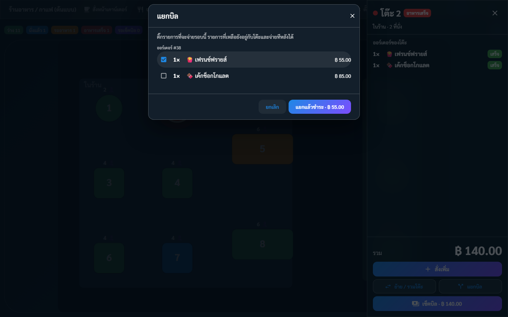

1. กด **แยกบิล** จากแผงโต๊ะ
2. ติ๊กรายการที่จะจ่ายรอบนี้ — บรรทัดที่มีหลายจานปรับได้ด้วย − / + (เช่น ลาเต้ 3 แก้ว จ่ายก่อน 1 แก้ว → กดจนขึ้น **1/3**)
3. กด **แยกแล้วชำระ · ฿…** → รายการที่ติ๊กกลายเป็นออร์เดอร์ของตัวเองและเข้าหน้าชำระเงินทันที
4. รายการที่เหลือยังอยู่กับโต๊ะ จ่ายทีหลังได้

> **หารเท่ากัน N คน** ให้ใช้วิธีอื่น: กด **เช็คบิล** ทั้งโต๊ะแล้วใน หน้าชำระเงินกด **เพิ่มช่องทางชำระ** หลายแถว แบ่งยอดตามจำนวนคน

---

## 8. จอเรียกคิว

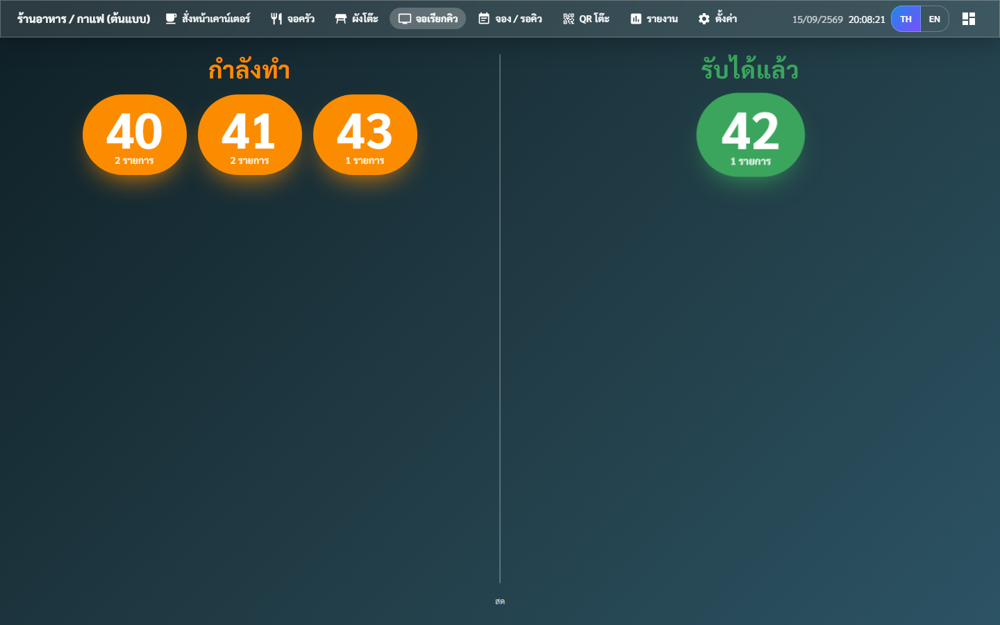

หน้าจอสำหรับต่อทีวีหน้าเคาน์เตอร์ให้ลูกค้าดู

- ซ้าย **กำลังทำ** — คิวที่ครัวยังทำอยู่
- ขวา **รับได้แล้ว** — คิวที่ทำเสร็จครบ (กล่องกะพริบเบา ๆ)
- เลขวิ่งข้ามฝั่งเองทันทีที่ครัวกด "เสร็จ" ไม่ต้องรีเฟรช
- แสดงเฉพาะออร์เดอร์ที่ไม่มีโต๊ะ (เคาน์เตอร์/กลับบ้าน/เดลิเวอรี) — อาหารของโต๊ะเสิร์ฟถึงที่อยู่แล้ว
- บรรทัดล่างสุดบอกสถานะการเชื่อมต่อ (**สด** / ออฟไลน์)

> เปิดจอนี้แบบเต็มจอ (กด F11) บนเครื่องที่ต่อทีวี แล้วปล่อยค้างไว้ได้ทั้งวัน

---

## 9. QR โต๊ะ — ลูกค้าสั่งเอง

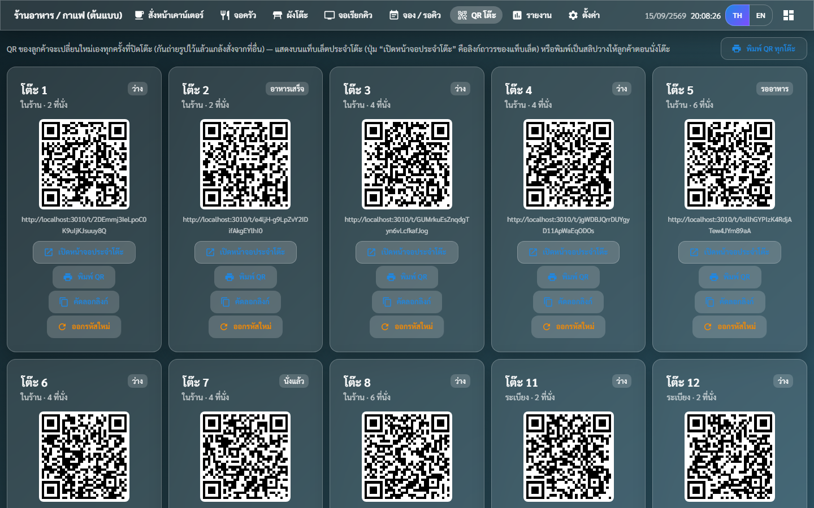

ลูกค้าสแกน QR ที่โต๊ะแล้วสั่งจากมือถือตัวเองได้ทันที **ไม่ต้องติดตั้งแอป ไม่ต้องล็อกอิน**

### 9.1 หลักการสำคัญ: รหัสเปลี่ยนทุกครั้งที่ปิดโต๊ะ

โต๊ะหนึ่งมี 2 ลิงก์

| ลิงก์ | ใครใช้ | เปลี่ยนเมื่อไหร่ |
|---|---|---|
| **รหัสลูกค้า** (ใน QR) | มือถือลูกค้าที่สแกน | **ทุกครั้งที่ปิดโต๊ะ** หรือกด "ออกรหัสใหม่" |
| **ลิงก์แท็บเล็ต** (ปุ่ม *เปิดหน้าจอประจำโต๊ะ*) | แท็บเล็ตที่วางประจำโต๊ะ | ไม่เปลี่ยนเลย |

เมื่อปิดโต๊ะ: รหัสเดิมใช้ไม่ได้ทันที (ลูกค้าที่ถ่ายรูป QR ไว้แล้วกลับไปบ้านจะสั่งไม่ได้) · แท็บเล็ตประจำโต๊ะได้รหัสใหม่เองผ่านระบบเรียลไทม์ ไม่ต้องรีโหลด · มือถือที่ค้างหน้าเดิมจะขึ้น "ขอบคุณที่ใช้บริการ — QR นี้หมดอายุแล้ว"

### 9.2 วิธีใช้งาน 2 แบบ

**แบบ ก. แท็บเล็ตประจำโต๊ะ (แนะนำ)** — กด **เปิดหน้าจอประจำโต๊ะ** บนแท็บเล็ตแล้ววางไว้ที่โต๊ะ จอจะแสดง QR ใหญ่และเปลี่ยนรหัสให้เองทุกครั้งที่ปิดโต๊ะ ลูกค้าจะสแกนจากจอนี้ หรือกด "สั่งจากหน้าจอนี้" ก็ได้

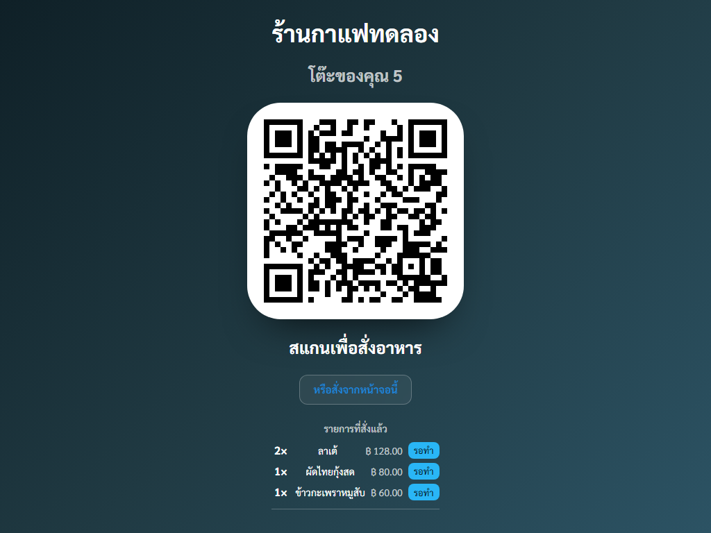

**แบบ ข. พิมพ์สลิป QR** — กด **พิมพ์ QR** ในการ์ดของโต๊ะ (หรือ **พิมพ์ QR ทุกโต๊ะ** ตอนเปิดร้าน) สลิปออกเครื่องพิมพ์ใบเสร็จ วางให้ลูกค้าตอนพาเข้านั่ง

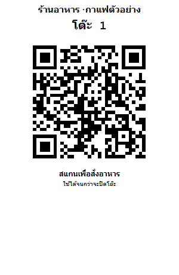

> เพราะรหัสเปลี่ยนทุกครั้งที่ปิดโต๊ะ **อย่าพิมพ์ QR ติดถาวรที่โต๊ะ** — ให้พิมพ์ใหม่ตอนพาลูกค้านั่ง หรือใช้แท็บเล็ต

### 9.3 หน้าจอที่ลูกค้าเห็น

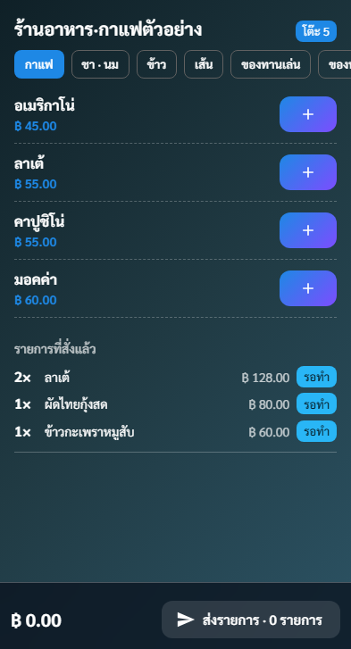

ลูกค้าเลือกหมวด แตะเมนู เลือกตัวเลือก แล้วกด **ส่งรายการ** ออร์เดอร์วิ่งเข้าจอครัวทันที และลูกค้าเห็นสถานะของจานตัวเอง (รอทำ / กำลังทำ / เสร็จ) อัปเดตสด

- ลูกค้าเห็นเฉพาะเมนูที่ติ๊กช่องทาง **ลูกค้าสั่งเอง** ไว้ในหน้าตั้งค่าเมนู
- ลูกค้าสั่งได้อย่างเดียว **ไม่เห็นข้อมูลร้าน ไม่เห็นโต๊ะอื่น และจ่ายเงินไม่ได้** (เก็บเงินที่เคาน์เตอร์/ที่โต๊ะตามปกติ)

### 9.4 ปุ่มอื่นในการ์ดโต๊ะ

- **คัดลอกลิงก์** — คัดลอกที่อยู่ QR ของโต๊ะ (ไว้ส่งให้ลูกค้าทางไลน์ หรือเอาไปทำป้าย)
- **ออกรหัสใหม่** — เปลี่ยนรหัสทันทีโดยไม่ต้องรอปิดโต๊ะ (ใช้เวลา QR หลุดออกไปข้างนอก)

### 9.5 กติกา "ต้องเปิดโต๊ะก่อนลูกค้าถึงสั่งได้"

เปิดสวิตช์นี้ที่ **ตั้งค่า → สต็อก / เงิน** เพื่อกันคนที่ถ่ายรูป QR ของโต๊ะว่างไปสั่งจากที่อื่น

- โต๊ะที่ยังไม่มีใครนั่ง: มือถือลูกค้าจะขึ้น **"โต๊ะนี้ยังไม่เปิด กรุณาเรียกพนักงาน"** และสั่งไม่ได้
- พนักงานกด **เปิดโต๊ะ (ยังไม่สั่ง)** ที่ผังโต๊ะ (หรือรับออร์เดอร์แรกให้เอง) → มือถือลูกค้าปลดล็อกเองทันที ไม่ต้องสแกนใหม่

---

## 10. จอง / รอคิว

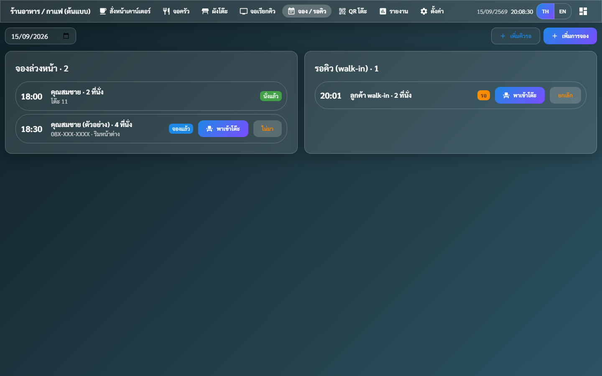

หน้าจอนี้แยกเป็น 2 ฝั่ง

- **จองล่วงหน้า** — ลูกค้าที่โทรมาจอง เรียงตามเวลา เลือกวันได้ที่ช่องวันที่มุมซ้ายบน
- **รอคิว (walk-in)** — ลูกค้าที่มาถึงแล้วแต่โต๊ะเต็ม

**เพิ่มรายการ** — กด **เพิ่มการจอง** หรือ **เพิ่มคิวรอ** แล้วกรอกชื่อ เบอร์โทร จำนวนคน เวลา (เฉพาะการจอง) และหมายเหตุ

**พาเข้าโต๊ะ** — กดปุ่มนี้แล้วเลือกโต๊ะว่าง ระบบจะ

1. เปลี่ยนสถานะรายการเป็น **นั่งแล้ว** พร้อมจดเลขโต๊ะ
2. **เปิดโต๊ะให้อัตโนมัติ** — ผังโต๊ะเปลี่ยนเป็นน้ำเงิน และ QR ของโต๊ะเริ่มรับออร์เดอร์ได้ทันที

**ไม่มา / ยกเลิก** — กดเพื่อปิดรายการที่ลูกค้าไม่มาตามนัด (รายการจะจางลงแต่ยังเก็บไว้ในสมุด)

---

## 11. รายงานร้านอาหาร

เลือกช่วงวันที่มุมขวาบน (มีปุ่มลัด วันนี้ / เดือนนี้ / ปีนี้ / ทั้งหมด) และกด **CSV** เพื่อดาวน์โหลดไปเปิดใน Excel ได้ทุกแท็บ

### 11.1 เมนู / กำไรต่อจาน

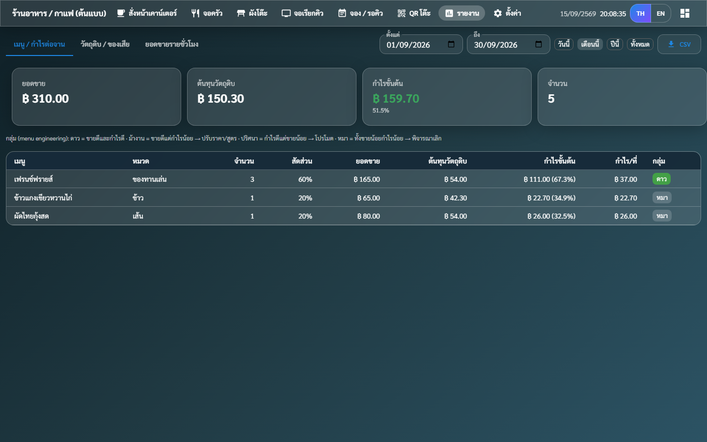

การ์ดบนสุด: ยอดขาย · ต้นทุนวัตถุดิบ · กำไรขั้นต้น (พร้อม %) · จำนวนที่ขายได้

ตารางแสดงรายเมนู พร้อม **กลุ่ม** ตามหลัก menu engineering

| กลุ่ม | ความหมาย | ควรทำอะไร |
|---|---|---|
| **ดาว** | ขายดี กำไรดี | รักษาคุณภาพ ดันเป็นเมนูแนะนำ |
| **ม้างาน** | ขายดี แต่กำไรน้อย | ปรับราคาขึ้นเล็กน้อย หรือลดต้นทุนสูตร |
| **ปริศนา** | กำไรดี แต่ขายน้อย | โปรโมต ย้ายไปอยู่ต้นเมนู แนะนำโดยพนักงาน |
| **หมา** | ขายน้อย กำไรน้อย | พิจารณาเลิกขาย |

### 11.2 วัตถุดิบ / ของเสีย

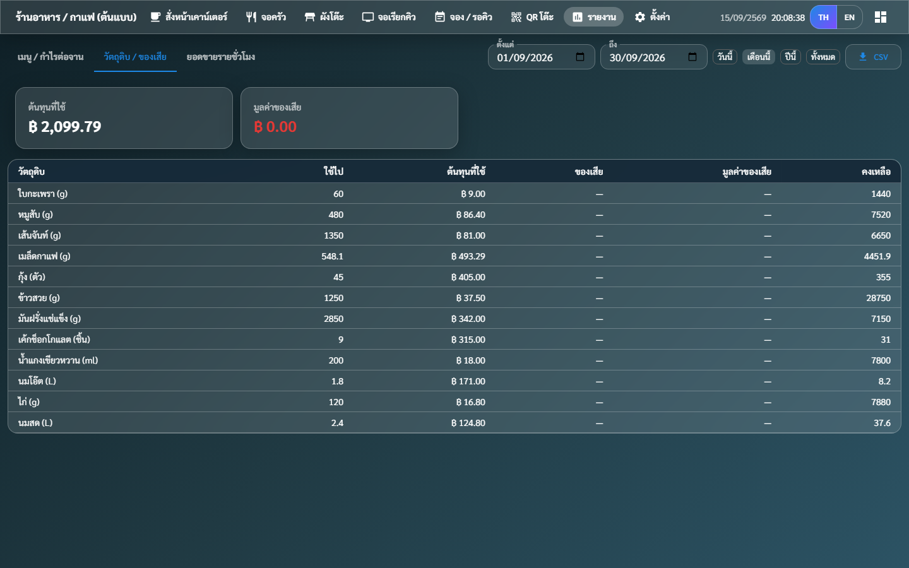

บอกว่าช่วงที่เลือก **ใช้วัตถุดิบไปเท่าไหร่ คิดเป็นเงินเท่าไหร่** และ **ของเสียเท่าไหร่** (ของเสีย = จานที่ทำไปแล้วแต่ถูกยกเลิก) พร้อมยอดคงเหลือปัจจุบัน ใช้ตรวจว่าของหายผิดปกติหรือไม่ และใช้วางแผนสั่งของ

### 11.3 ยอดขายรายชั่วโมง

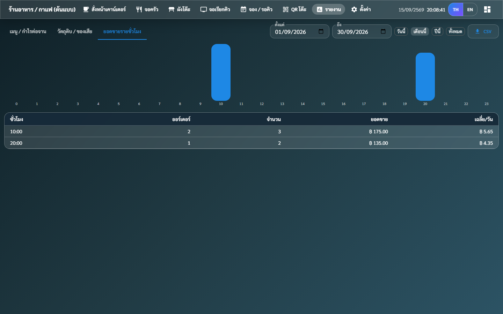

กราฟและตารางบอกว่าชั่วโมงไหนคนเยอะ ใช้จัดตารางพนักงานและเตรียมของล่วงหน้า คอลัมน์ **เฉลี่ย/วัน** หารด้วยจำนวนวันในช่วงที่เลือกให้แล้ว

---

## 12. ตั้งค่า

หน้าตั้งค่ามี 6 แท็บ เข้าได้เฉพาะผู้จัดการและเจ้าของร้าน

### 12.1 เมนู

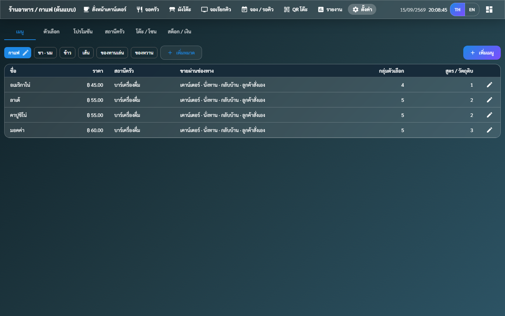

- แถวบนคือ **หมวด** — กด **เพิ่มหมวด** เพื่อสร้าง หรือกดไอคอนดินสอบนหมวดที่เลือกอยู่เพื่อแก้ชื่อ/ลำดับ/ปิดใช้
- ตารางคือเมนูในหมวดนั้น กด **เพิ่มเมนู** หรือไอคอนดินสอท้ายแถวเพื่อแก้

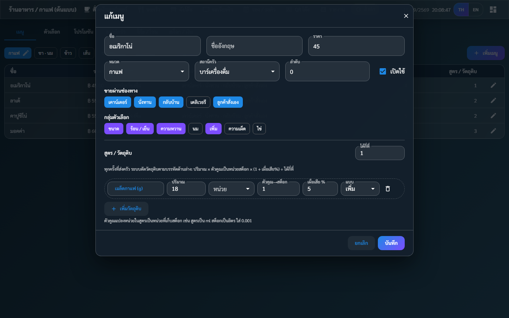

ในหน้าต่างแก้เมนูตั้งได้ครบ

| ช่อง | ความหมาย |
|---|---|
| **ชื่อ / ชื่ออังกฤษ / ราคา** | |
| **หมวด**, **สถานีครัว** | สถานีคือจุดที่ทำเมนูนี้ — ตั๋วจะวิ่งไปจอ/เครื่องพิมพ์ของสถานีนั้น |
| **ลำดับ**, **เปิดใช้** | ลำดับการแสดงบนไทล์ · ปิดใช้ = ซ่อนจากหน้าขายโดยไม่ลบประวัติ |
| **ขายผ่านช่องทาง** | เคาน์เตอร์ / นั่งทาน / กลับบ้าน / เดลิเวอรี / **ลูกค้าสั่งเอง** (ช่องทางสุดท้ายคือ QR โต๊ะ) |
| **กลุ่มตัวเลือก** | ติ๊กกลุ่มที่เมนูนี้ต้องถาม เช่น ขนาด ร้อน/เย็น |
| **สูตร / วัตถุดิบ** | ดูข้อ 13 |

### 12.2 ตัวเลือก

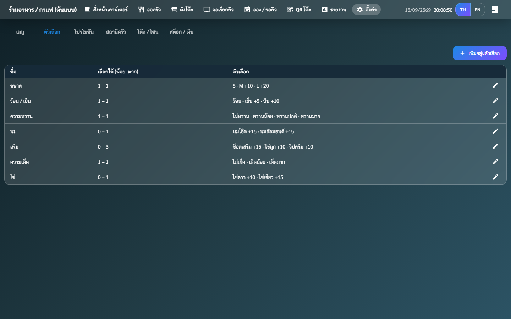

กลุ่มตัวเลือกใช้ซ้ำได้หลายเมนู แต่ละกลุ่มตั้ง

- **น้อยสุด / มากสุด** — น้อยสุด 0 = ไม่บังคับ · น้อยสุด 1 มากสุด 1 = ต้องเลือก 1 อย่าง (เช่น ขนาด)
- ตัวเลือกแต่ละตัวมี **ชื่อ**, **บวกราคา**, **ค่าเริ่มต้น** (ติ๊กไว้ให้ล่วงหน้า) และ **วัตถุดิบของตัวเลือกนี้** เช่น
  - *เพิ่มช็อต* → เพิ่ม เมล็ดกาแฟ 18 กรัม (แบบ **เพิ่ม**)
  - *นมโอ๊ต* → ใช้ นมโอ๊ต 200 ml **แทน** นมสด (แบบ **แทนที่**)

### 12.3 โปรโมชัน

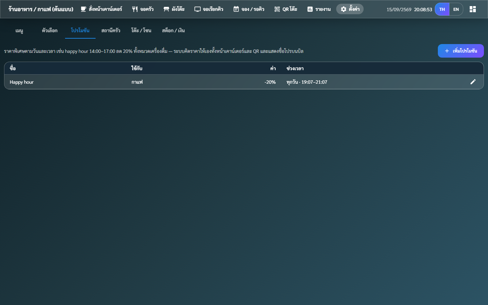

ตั้งราคาพิเศษตามวันและเวลา เช่น happy hour 14:00–17:00 ลด 20% ทั้งหมวดเครื่องดื่ม

| ช่อง | ความหมาย |
|---|---|
| **ใช้กับ** | ทั้งหมวด หรือเฉพาะเมนูเดียว |
| **แบบลด** | ลดเป็น % · ลดเป็นบาท · ราคาพิเศษ (ตั้งราคาตายตัว) |
| **วัน** | ติ๊กวันในสัปดาห์ที่โปรทำงาน |
| **ตั้งแต่ / ถึง** | ช่วงเวลาในแต่ละวัน |
| **เริ่มวันที่ / สิ้นสุดวันที่** | ช่วงวันที่ของแคมเปญ (เว้นว่างได้ = ไม่จำกัด) |

ระบบคิดราคาให้เองทั้งหน้าเคาน์เตอร์และ QR โต๊ะ ไทล์จะขึ้นป้ายชื่อโปรพร้อมขีดฆ่าราคาเดิม และ**ชื่อโปรจะปรากฏบนบิล** ถ้ามีหลายโปรที่ใช้ได้พร้อมกัน ระบบเลือกอันที่ลูกค้าได้ราคาถูกที่สุด

### 12.4 สถานีครัว

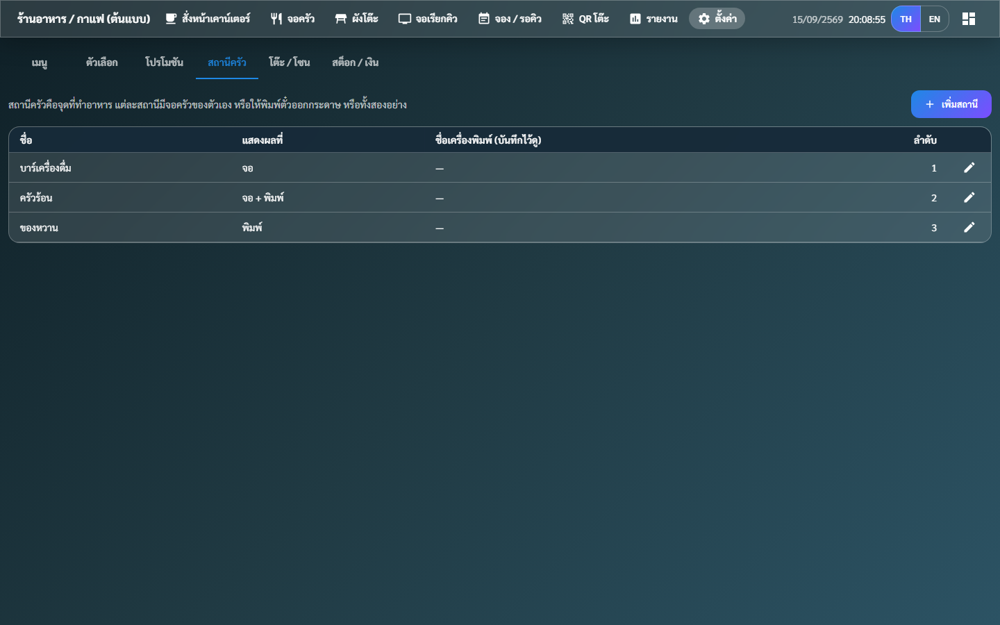

สร้างจุดทำอาหาร และเลือก **แสดงผลที่**: *จอ* (KDS อย่างเดียว) · *กระดาษ* (พิมพ์ตั๋ว) · *จอ + กระดาษ* ช่อง **ชื่อเครื่องพิมพ์** เป็นแค่บันทึกไว้ดู — การเลือกว่าเครื่องไหนพิมพ์ให้สถานีไหนทำที่หน้าจอครัว (ข้อ 5.3)

### 12.5 โต๊ะ / โซน

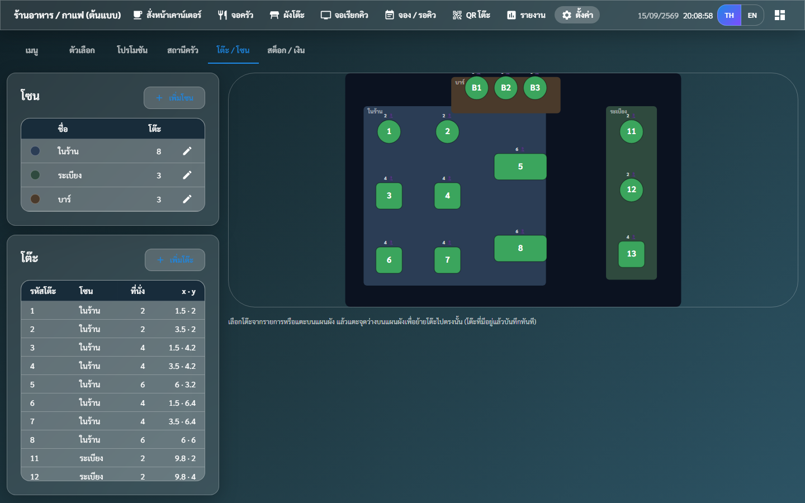

1. สร้าง **โซน** ก่อน (ในร้าน, ระเบียง, บาร์) เลือกสีพื้นของโซนได้
2. กด **เพิ่มโต๊ะ** กรอกรหัสโต๊ะ (เช่น `5`, `B1`), โซน, จำนวนที่นั่ง, รูปทรง (กลม/เหลี่ยม/ยาว)
3. **วางตำแหน่ง** — เลือกโต๊ะจากรายการ แล้วแตะจุดที่ต้องการบนแผนผัง (โต๊ะที่มีอยู่แล้วบันทึกทันที)
4. ปรับละเอียดได้ที่ช่อง x / y (เมตร) และ **หมุน (°)**

> รหัสโต๊ะคือสิ่งที่ออร์เดอร์และ QR ใช้อ้างอิง — เปลี่ยนชื่อโซนหรือย้ายตำแหน่งได้ตลอดโดยไม่กระทบออร์เดอร์เก่า แต่ถ้าเปลี่ยน **รหัสโต๊ะ** ให้ทำตอนโต๊ะว่าง

### 12.6 สต็อก / เงิน

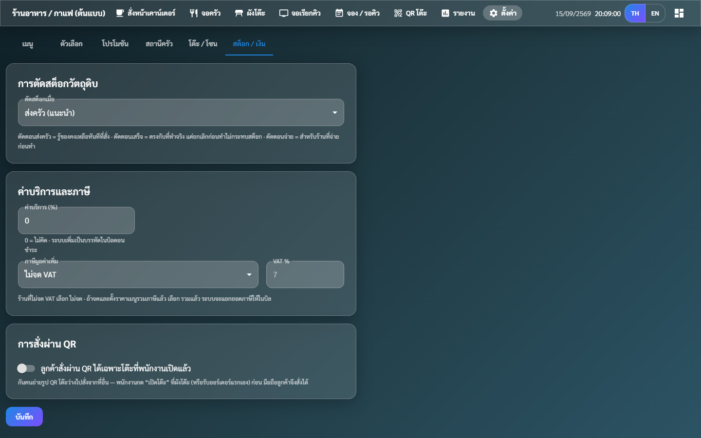

| หัวข้อ | ตัวเลือก |
|---|---|
| **ตัดสต็อกเมื่อ** | *ส่งครัว* (แนะนำ — รู้ของคงเหลือทันทีที่สั่ง) · *ครัวกดเสร็จ* (ตรงกับที่ทำจริง ยกเลิกก่อนทำไม่กระทบสต็อก) · *ชำระเงิน* (สำหรับร้านที่เก็บเงินก่อนทำ) |
| **ค่าบริการ (%)** | 0 = ไม่คิด · ระบบเพิ่มเป็นบรรทัดในบิลตอนชำระ |
| **ภาษีมูลค่าเพิ่ม** | *ไม่จด VAT* · *ราคารวม VAT แล้ว* (แยกยอดภาษีให้ดูในบิล) · *ราคายังไม่รวม VAT* (บวกเพิ่มตอนชำระ) พร้อมช่อง **VAT %** |
| **ลูกค้าสั่งผ่าน QR ได้เฉพาะโต๊ะที่พนักงานเปิดแล้ว** | สวิตช์ตามข้อ 9.5 |

กด **บันทึก** แล้วค่าใหม่มีผลทันทีทุกเครื่อง

---

## 13. สูตรอาหารและการตัดสต็อกวัตถุดิบ

นี่คือหัวใจที่ทำให้ระบบรู้ต้นทุนจริงต่อจานและรู้ว่าของจะหมดเมื่อไหร่

### 13.1 ใส่สูตรอย่างไร

ในหน้าต่างแก้เมนู (ข้อ 12.1) ส่วน **สูตร / วัตถุดิบ** กด **เพิ่มวัตถุดิบ** แล้วกรอกทีละบรรทัด

| ช่อง | ความหมาย | ตัวอย่าง |
|---|---|---|
| **วัตถุดิบ** | เลือกจากสินค้าในสต็อก | เมล็ดกาแฟ |
| **ปริมาณ** | ปริมาณที่ใช้ต่อ 1 ที่ (ตามหน่วยในสูตร) | 18 |
| **หน่วย** | หน่วยที่ใช้เขียนสูตร | กรัม |
| **ตัวคูณ→สต็อก** | แปลงหน่วยสูตรเป็นหน่วยที่เก็บสต็อก | สูตรเป็น ml สต็อกเป็นลิตร → `0.001` |
| **เผื่อเสีย %** | เผื่อส่วนที่สูญเสียระหว่างทำ | 5 |
| **แบบ** | *เพิ่ม* (ใส่เพิ่ม) หรือ *แทนที่* (ใช้แทนวัตถุดิบอื่น เช่น นมโอ๊ตแทนนมสด) | |

ช่อง **ได้กี่ที่** ด้านบนใช้กับสูตรแบบหม้อ เช่น น้ำแกงหม้อหนึ่งได้ 10 ชาม ใส่ 10 แล้วระบบหารให้ต่อที่เอง

### 13.2 ระบบคำนวณอย่างไร

```
ตัดสต็อก = ปริมาณ × ตัวคูณเป็นหน่วยสต็อก × (1 + เผื่อเสีย%) × จำนวนที่สั่ง ÷ ได้กี่ที่
```

**ตัวอย่างจริง** — ลาเต้ 1 แก้ว สูตร เมล็ดกาแฟ 18 กรัม เผื่อเสีย 5% + นมสด 200 ml (ตัวคูณ 0.001) ลูกค้าสั่ง "ลาเต้ นมโอ๊ต เพิ่มช็อต" 1 แก้ว

- เมล็ดกาแฟ: 18 × 1.05 = 18.9 กรัม **+ ช็อตเสริมอีก** 18 × 1.05 = 18.9 → รวม **37.8 กรัม**
- นมโอ๊ต: 200 × 0.001 = **0.2 ลิตร**
- นมสด: **ไม่ถูกตัด** เพราะตัวเลือก "นมโอ๊ต" ตั้งเป็นแบบ *แทนที่*
- ต้นทุนรวมของแก้วนี้บันทึกไว้กับบรรทัดออร์เดอร์ และไปโผล่ในรายงานเมนู

### 13.3 ยกเลิกแล้วสต็อกเป็นอย่างไร

- **ยกเลิกก่อนครัวทำ** → วัตถุดิบคืนเข้าสต็อกทั้งหมด
- **ยกเลิกหลังทำแล้ว** → สต็อกไม่คืน แต่บันทึกเป็น **ของเสีย** และไปโผล่ในรายงานวัตถุดิบ/ของเสีย

### 13.4 เมนูที่ไม่ต้องตัดสต็อก

เมนูที่ไม่ใส่สูตรเลย (เช่น ค่าบริการพิเศษ หรือของที่นับสต็อกเป็นชิ้นอยู่แล้ว) จะไม่ตัดอะไร — ปล่อยส่วนสูตรว่างไว้ได้

---

## 14. หลายสาขา (สำนักงานใหญ่)

เจ้าของหลายสาขาที่มีบัญชี **ผู้ดูแลแพลตฟอร์ม** จะเห็นเมนู **สำนักงานใหญ่** ในระบบหลังร้าน — ทุกร้านในหน้าเดียว: จำนวนบิล ยอดขายสุทธิ และออร์เดอร์ที่เปิดค้างอยู่ตอนนี้ เลือกช่วงวันที่และดาวน์โหลด CSV ได้ กดปุ่มท้ายแถวเพื่อเข้าไปดูร้านนั้นโดยตรง

---

## 15. ปัญหาที่พบบ่อยและวิธีแก้

| อาการ | สาเหตุ / วิธีแก้ |
|---|---|
| **ออร์เดอร์ไม่ขึ้นจอครัว** | เมนูนั้นยังไม่ได้ผูก **สถานีครัว** → แก้ที่ตั้งค่า → เมนู · หรือจอครัวกรองอยู่ที่สถานีอื่น ให้กดชิป **ทั้งหมด** |
| **ตั๋วไม่ออกกระดาษ** | สถานีตั้งเป็น *จอ* อย่างเดียว → เปลี่ยนเป็น *กระดาษ* หรือ *จอ + กระดาษ* · หรือเครื่องนั้นยังไม่ได้ติ๊กสถานีที่ **จอครัว → เครื่องพิมพ์ครัว** · เครื่องต้องเปิดหน้าจอครัวค้างไว้ |
| **เมนูไม่ขึ้นบนไทล์** | ปิดใช้อยู่ หรือไม่ได้ติ๊กช่องทางที่กำลังใช้ (เช่น ไม่ได้ติ๊ก "กลับบ้าน") |
| **ลูกค้าสแกน QR แล้วขึ้น "QR นี้ใช้ไม่ได้แล้ว"** | รหัสถูกเปลี่ยนเพราะปิดโต๊ะไปแล้ว หรือมีคนกด "ออกรหัสใหม่" → ให้ลูกค้าสแกนจากแท็บเล็ต/สลิปใบใหม่ |
| **ลูกค้าขึ้น "โต๊ะนี้ยังไม่เปิด"** | เปิดสวิตช์กติกาข้อ 9.5 ไว้ → พนักงานกด **เปิดโต๊ะ (ยังไม่สั่ง)** ที่ผังโต๊ะ |
| **สต็อกวัตถุดิบไม่ลด** | เมนูนั้นยังไม่มีสูตร → ใส่สูตรที่ตั้งค่า → เมนู · หรือตั้ง **ตัดสต็อกเมื่อ** เป็น *ครัวกดเสร็จ* / *ชำระเงิน* ซึ่งจะยังไม่ตัดตอนส่งครัว |
| **ยอดขายไม่เข้าแดชบอร์ด** | ออร์เดอร์ยังไม่ได้ **ชำระเงิน** — ออร์เดอร์ที่ส่งครัวแล้วแต่ยังไม่เก็บเงินจะยังไม่เป็นบิล ให้เช็คบิลที่โต๊ะ หรือกดชิป **รอชำระ** ที่หน้าเคาน์เตอร์ |
| **ผังโต๊ะ 3D กระตุก** | ระบบสลับเป็น 2D ให้เองเมื่อเครื่องช้า · กดปุ่ม **2D** ค้างไว้ได้ |
| **แถบล่างจอเรียกคิวขึ้น "ออฟไลน์"** | เน็ตหลุดชั่วคราว ระบบต่อกลับให้เอง และยังดึงข้อมูลทุก 3 วินาทีระหว่างนั้น |

---

## 16. ภาคผนวก

### 16.1 สถานะออร์เดอร์และโต๊ะ

| สถานะออร์เดอร์ | ความหมาย |
|---|---|
| **เปิด** | ยังไม่ได้เก็บเงิน |
| **จ่ายแล้ว** | ออกบิลแล้ว — โต๊ะยังไม่ปิด / คิวยังไม่รับของ |
| **ปิด** | จบสิ้นเชิง (ปิดโต๊ะ หรือเสิร์ฟครบสำหรับคิวที่จ่ายแล้ว) |
| **ยกเลิก** | ยกเลิกทั้งใบ |

| สถานะรายจาน | ความหมาย |
|---|---|
| **รอทำ** | ส่งครัวแล้ว ยังไม่เริ่ม |
| **กำลังทำ** | ครัวรับแล้ว |
| **เสร็จ** | พร้อมเสิร์ฟ/รับ |
| **เสิร์ฟแล้ว** | ถึงมือลูกค้า (หายจากจอครัว) |
| **ยกเลิก** | ยกเลิกรายจาน |

### 16.2 ตารางสิทธิ์โดยย่อ

| การทำงาน | เจ้าของร้าน | ผู้จัดการ | แคชเชียร์ |
|---|:-:|:-:|:-:|
| รับออร์เดอร์ ส่งครัว เช็คบิล ปิดโต๊ะ | ✅ | ✅ | ✅ |
| ย้าย/รวมโต๊ะ แยกบิล เปิดโต๊ะ | ✅ | ✅ | ✅ |
| จอง / รอคิว, QR โต๊ะ (ดูและพิมพ์) | ✅ | ✅ | ✅ |
| ออกรหัส QR ใหม่ | ✅ | ✅ | – |
| ตั้งค่าเมนู สูตร ตัวเลือก โปรโมชัน สถานี โต๊ะ | ✅ | ✅ | – |
| รายงานร้านอาหาร | ✅ | ✅ | – |

### 16.3 คำศัพท์

| คำ | หมายถึง |
|---|---|
| **ออร์เดอร์** | รายการที่ส่งครัว 1 ครั้ง (1 โต๊ะมีได้หลายออร์เดอร์) |
| **บิล** | เอกสารการขายที่ออกตอนรับเงิน — ออร์เดอร์หลายใบรวมเป็นบิลเดียวได้ |
| **สถานี** | จุดทำอาหาร เช่น บาร์ ครัวร้อน ของหวาน |
| **ตัวเลือก (modifier)** | คำถามที่ถามตอนสั่ง เช่น ขนาด ความหวาน |
| **KDS** | Kitchen Display System = จอครัว |
| **โทเค็น QR** | รหัสลับในลิงก์ QR ของโต๊ะ |

---

*คู่มือนี้อยู่ในระบบด้วย — เข้าเมนู **คู่มือ** ในระบบหลังร้าน แล้วเลือกแท็บ "คู่มือร้านอาหาร / กาแฟ" (พิมพ์เก็บเป็นเล่มได้ด้วยปุ่มพิมพ์)*
